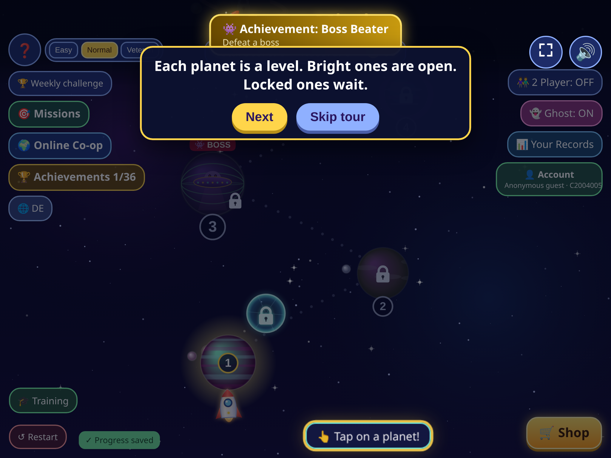
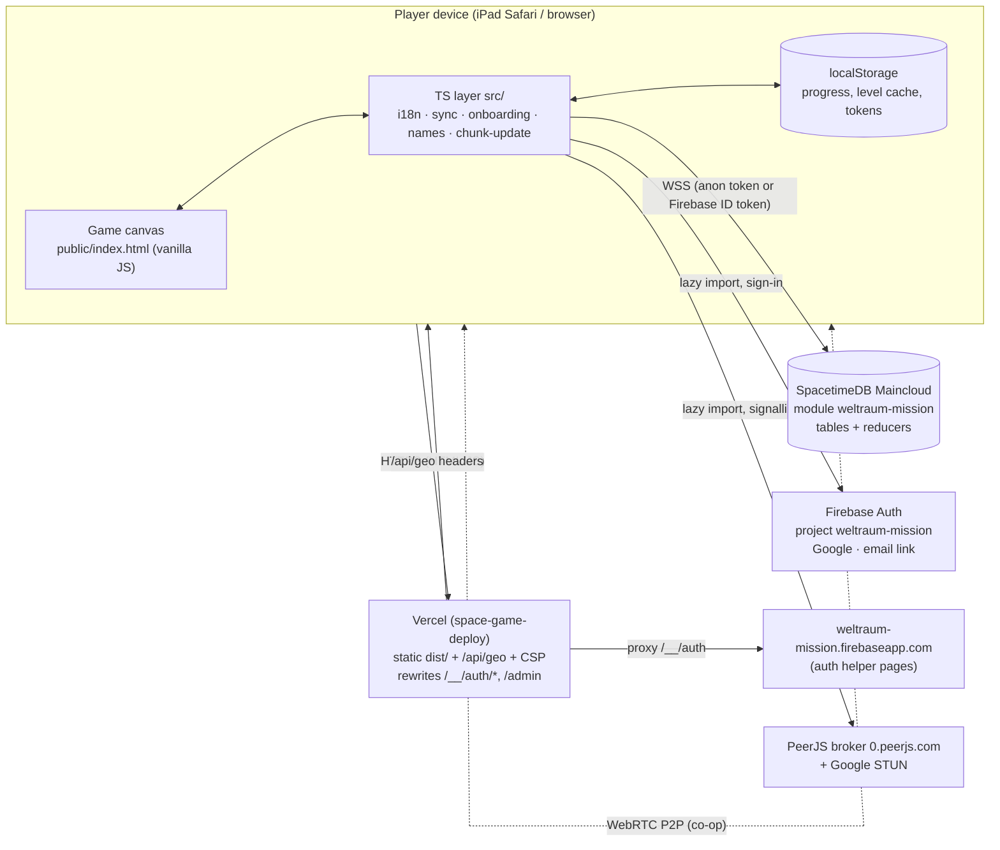
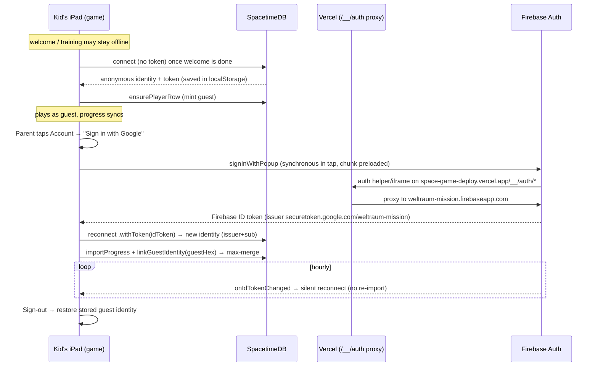

# Weltraum-Mission

## Handover Document

**A kid-friendly HTML5 space shooter for iPad and the web**

| | |
|---|---|
| **Owner** | Suman Kumar Polepaka (GitHub: `spolepaka`) |
| **Repository** | `github.com/spolepaka/weltraum-mission` (private) |
| **Live site** | https://space-game-deploy.vercel.app |
| **Code state** | `main` @ `e1759f0` (PRs #1–#25 merged). Drafts stacked after that: #26 versus, then this catalog/TURN/docs PR. |
| **Document date** | 22 October 2026 (covers PRs #17–#26 plus this follow-up) |
| **Audience** | A new developer or owner taking over with no prior context |

*Built for Joshi (9, German Gymnasium, plays on iPad) and his sister Amelia.*

## How to read this document

- Facts were checked against the repository (`main` at `e1759f0` plus the versus and catalog drafts), the GitHub PR list, and the module source on 22 Oct 2026. Anything not re-checked is marked **(unverified)**.
- All times are Europe/Berlin (CEST, UTC+2) unless marked otherwise.
- No secrets, tokens or API keys appear here. Section 13 says where each one lives.
- Start here, then use [DEPLOY.md](DEPLOY.md) for publish / Vercel / Firebase steps and the root [README.md](../README.md) for a short orientation.

## Table of contents

1. Executive summary
2. Game overview and features
3. Architecture
4. Repository layout
5. Data model (SpacetimeDB)
6. Authentication flow
7. Deployment and operations runbook
8. Testing
9. Changelog / PR history
10. Bugs fixed (problem / cause / fix)
11. Known issues and tech debt
12. Roadmap
13. Accounts, ownership and where config lives
14. Glossary

## 1. Executive summary

**Weltraum-Mission** ("Space Mission") is a 2D vertical space shooter that runs in the browser and is tuned for the iPad (touch at 1024×768 landscape and 768×1024 portrait). It started as a German, single-file HTML5 canvas game for the owner's children. Over two days of fast iteration (9–11 Oct 2026, mostly done by AI coding agents) it grew into a 100-level game with 34 boss fights, a shop with 29 ships, local and online co-op, onboarding, optional parent accounts, and a private admin console.

**How it is built today:**

- **Client:** a large vanilla-JS game file (`public/index.html`, about 7,400 lines). Vite processes it, and TypeScript modules in `src/` add backend sync, i18n (English by default, German toggle), lazy level loading, onboarding, names, auth and update handling. Hosted on **Vercel** (project `space-game-deploy`). A second Vite entry (`admin.html`) is the unlinked `/admin` dashboard.
- **Game data backend:** a **SpacetimeDB** TypeScript module named `weltraum-mission` on **Maincloud**. Players get an anonymous identity, progress syncs to the server, the server checks results for plausibility, levels 4–100 are only delivered once unlocked, and there is a weekly leaderboard, first-party analytics, admin reducers and presence.
- **Accounts:** optional parent sign-in with **Firebase Auth** (Google and passwordless email link; Apple is wired but switched off). The Firebase ID token is passed to SpacetimeDB, which keeps all game data. Firebase auth is proxied through the game's own domain so sign-in works in iPad Safari. Guest progress can be linked / merged into a Google identity.
- **Online:** peer-to-peer over **PeerJS/WebRTC**. Co-op is 2–5 players by room code. **1 vs 1 versus** (PR #26) is a mirrored duel with SpacetimeDB matchmaking and a server-side prize. ICE uses free Google STUN; optional TURN is `VITE_TURN_URL` / `VITE_TURN_USERNAME` / `VITE_TURN_CREDENTIAL` (unset = STUN only). Co-op pays the same per player as solo; combat scales with player count.
- **Geo / IP:** `GET /api/geo` is a self-contained Vercel Node function. Truncated IP, 30-day retention, `STORE_FULL_IP = false`. The signature is **best-effort and spoofable** (the fallback secret is in the public repo).

**State at handover:** PRs #1–#25 are on `main`. #26 (versus) and this follow-up (TURN config, upgrade catalog, 36 achievements, hearts, `addOwnedShip`, docs) are stacked drafts. `/api/geo` is self-contained (PR #16). Pilot names bind to the signed-in Firebase account (#24). Admins see a live online count and can grant roles (#25).

**Pending:** Apple sign-in, a native iPad/mobile app, a **hosted** TURN URL in Vercel env (code is ready), and a module republish for #24–#26 plus this catalog/achievement/`addOwnedShip` PR.

## 2. Game overview and features



### 2.1 Core gameplay

- The player flies a rocket at the bottom of the screen. Drag to move and tap fire, or use arrow keys + Space on a keyboard.
- Enemies and hazards: asteroids (they split when shot, and "tough" asteroids from L19 show cracks), zig-zag UFOs (from L19 they fire aimed shots after a red warning blink), and comets.
- **Black holes** grow when you shoot them and pull objects in. If one swallows the ship, the run is lost instantly. They can also swallow and defeat bosses, but **not the final boss**: the Robo-Kaiser (`type: "emperor"`) gets a short immunity when it comes near a hole (verified in code). Since v30, drifting black holes appear only in some levels (L5, L10 and about 9% of L19+) and at most one at a time.
- **Wormholes:** portal pairs drift down from the top of the screen. Flying in sends the ship out of the centre of the partner portal, and an exit guard stops loops. This was reworked several times (v29, v30).
- **Laser grids:** about 3× rarer since v30 (at most 2 per level). They have 2 lines (3 from L40) with a wide gap.
- **Later hazards** (at most 1 per level, from L30): Sonnenwind (solar wind push), Ionensturm (ion storm, halves fire rate), Magnet-Minen (magnet mines), Schild-Satellit (a shield satellite that protects UFOs).
- **Power-ups:** shield, triple shot, extra heart, and others.
- **Hearts:** each ship uses the hearts on its definition (3–8) plus the one-time Extra Heart upgrade. The old 3/4 runtime cap is gone.
- **Coins:** collected in-level, plus a level-end bonus that already includes Joshi's requested **10×** multiplier. They carry over to the map, persist after reload and sync to the server (PR #2). Server and client cap a single clear so one match cannot buy the late shop. **Co-op pays the same per player as solo** (PR #13).
- **Stars** (up to 3 per level), best scores, **achievements** (the map shows "Achievements x/36"), **daily missions**, **records**.
- **Ghost ship:** replays your best run of a level (toggle "Ghost: ON/OFF").
- **Restart everything:** the map has a "Restart" button with a confirmation ("Restart everything?").

### 2.2 Levels and sectors

100 levels in 7 sectors (`SECTORS` in `public/index.html`):

| Levels | Sector (German name) | Theme |
|---|---|---|
| 1–18 | Heimat-Galaxie | Home galaxy |
| 19–30 | Nebel-Riff | Nebula reef |
| 31–45 | Eis-Galaxie | Ice galaxy |
| 46–60 | Lava-Sektor | Lava sector |
| 61–75 | Kristall-Wirbel | Crystal vortex |
| 76–90 | Schatten-Zone | Shadow zone |
| 91–100 | Kaiser-Reich | Emperor's realm |

- Each map planet is procedurally unique (palette, rings, moons, surface), and the level's background shows that planet (v29). On boss levels the planet shows its boss (v31). PR #14 fixed draw order so the mothership sits **on top of** the styled planet.
- Difficulty for L19+ follows `heat(L) = (1.3 + 0.5·(L−19)/80) · TUNE[batch] · TUNE_L[L]`. It was tuned by a simulated "human-like" bot (`tools/bot.js`, `tools/sim.mjs`). The balance results are in `docs/levels-log.md`.
- **Lazy loading:** levels 1–3 are built into the HTML. Levels 4–100 come from the server only when unlocked and are then cached in `localStorage` (`spaceMissionLevelCacheV1`).

### 2.3 Bosses

- Boss levels are **every 3rd level plus level 100**: `isBossLevel(L) = L % 3 === 0 || L === 100`, which gives 34 boss levels.
- Every boss level has its own boss:
  - hand-drawn bosses for L3–18, 30, 45, 60 and 90
  - 8 robot bosses (v32): L24 MECHA-STAMPFER, L36 TITAN-ROBOKOPF, L48 WANDEL-ROBOJET, L57 DROHNEN-TRÄGER-ROBOTER, L66 SPINNEN-MECH, L72 GIGA-ROBOSCHÄDEL, L81 TRANSFORMO-KREUZER, L96 SCHWARM-KOMMANDO-ROBOTER
  - 23 procedural designs with unique German names for the rest
- Joshi asked for space-themed bosses, so the animal-like ones were redesigned in v29. For example, Weltraum-Krake became Greifarm-Mutterschiff and Kristall-Drache became Kristall-Kreuzer.
- **Final boss, L100:** Robo-Weltraum-Kaiser ("ROBO-KAISER: FINALE FORM", 9,000 HP). It is immune to black holes. The ship "Kaiser-Brecher" does 1.6× damage against it.
- **Victory pause (PR #2):** after a boss kill there is a big explosion, "BOSS DEFEATED!", about 4.6 s of coin magnet, a coin tally, then a results screen.

### 2.4 Ships and shop

29 ships (`SHIPS` in `public/index.html`; the server whitelist in `VALID_SHIPS` matches). Abilities and stats scale with price. The shop has tabs, and upgrades are `rate`, `dmg`, `dur`, `mag` (max level 5) and `heart` (max 1).

| Price (coins) | Ships |
|---|---|
| 0 (default) | Starter-Rakete |
| 150 – 1,500 | Blitz-Jäger 150, Komet-Gleiter 250, Doppel-Kreuzer 400, Eis-Phantom 600, Plasma-Pfeil 800, Feuer-Jäger 1,000, Stern-Bomber 1,200, Ultra-Titan 1,500 |
| 2,000 – 20,000 | Laser-Lanze 2,000, Galaxie-König 3,000, Nova-Zerstörer 5,000, Quanten-Phantom 8,000, Universums-Titan 12,000, Nebel-Gleiter 15,000, Sonnenfeuer-Kreuzer 20,000 |
| 30,000 – 160,000 | Meteor-Hammer 30,000, Zwillings-Stern 38,000, Gravitron 52,000, Spektral-Geist 65,000, Sonnen-Segler 85,000, Schatten-Jäger 105,000, Galaxie-Flaggschiff 125,000, Omega-Stern 160,000 |
| Unlocked by level progress | Frost-Frachter (L30), Gewitter-Korvette, Smaragd-Dreizack, Regenbogen-Komet, Kaiser-Brecher (L90). Only the L30 and L90 unlock levels were checked. |

Player 2 in local co-op flies the special pink "Amelia-Rakete".

**Economy (PR #13):** the 10× late-boss bonus stays (L99 3-star bonus is 11,630 coins). That is why Suman saw 7,000+ coins after an online L99 — it is mostly the intended payout, not a sync/import double-add. `syncProgress` never writes coins; `mergeCoins` is max; `legacyImport` is one-shot. What *was* wrong: the old server cap was the fake `level × 5,000 × mode` (L99 = 495k), and every co-op peer received the same shared pickups. Caps are now `ceil((3-star bonus + typical pickups) × 1.35)` and **identical for 1–5 players**. One L99 cannot buy Phoenix (20k).

3-star Normal payout (solo = 2p = 5p):

| L | Bonus | Typical pickups | Expected | Cap |
|---|---|---|---|---|
| 1 | 370 | 26 | 396 | 535 |
| 10 | 640 | 80 | 720 | 972 |
| 30 boss | 4040 | 200 | 4240 | 5724 |
| 50 | 1840 | 320 | 2160 | 2916 |
| 75 boss | 8990 | 470 | 9460 | 12771 |
| 99 boss | 11630 | 614 | 12244 | 16530 |
| 100 boss | 11740 | 620 | 12360 | 16686 |

### 2.5 Secret codes (cheats)

To open the secret box, tap the **coin counter in the shop 5 times within 3 seconds**. Codes ignore case and spaces.

| Code | Effect | Intended for |
|---|---|---|
| `JOSHI10000` | +10,000 coins (once per identity) | Joshi |
| `AMELIA500` | +500 coins (once per identity) | Amelia |
| `JOSHIE1000000` (`JOSHI1000000` is also accepted) | +1,000,000 coins (once per identity) | Owner / testing |
| `ALLELEVEL` / `ALLELEVELS` (`ALLE LEVEL` also works because spaces are removed) | Unlocks all 100 levels for **this identity only** ("test mode"). "Restart" resets it. | Testing |

The codes are checked on the client and again on the server (`SECRET_CODES` in `server/spacetimedb/src/index.ts`, and the `usedSecretCode` table prevents reuse). Note: the codes can be read in the client source.

### 2.6 Multiplayer

- **Local 2-player on one iPad:** P1 controls the left side and P2 the right side ("2 Player: ON/OFF" toggle).
- **Online co-op (PeerJS/WebRTC):** the host creates a 5-character room code and up to 4 friends join (5 players total). A 6th player sees "room is full", and someone joining mid-level sees "busy". Each player has their own hearts.
- **1 vs 1 versus (PR #26):** Quick match or a private challenge code. Each player sees themselves at the bottom and the rival at the top. Fair 4-heart loadout, best of 3, disconnect = remaining player wins. Winner prize is 40 coins (daily cap 160), settled once on the server.
- **Admission:** new players are admitted automatically by default (the room code is the secret). The host can turn on "Ask before letting people in", and can **Kick** or block players. Kicked players cannot rejoin. Joins are rate-limited to 3 per minute (`src/coop-security.ts`).
- The host owns the game state. Guests receive snapshots, including solar wind and ion clouds.
- **Room-full bug (PR #13):** Joshi alone in a room, friend with the correct code saw "room is full". Cause: sticky `currentPlayers++` on every hello (never reset in `netTeardown` / `hostRoom`), `net.guests.length` counted not-ok ghosts, and `already_pending` was reported as full. Rooms are PeerJS-only (no server room table). Fix: occupancy = `1 + approved peers`, reconnect of an approved peer is allowed, teardown calls `coop.reset()`, `already_pending` → denied not full.
- **Co-op difficulty (PR #13):** old scaling ignored 2p and was only 1.5× HP / 1.12× spawn at 3p (too easy). New table (`src/lib/coop-scale.ts`):

| Players | Boss / enemy HP | Spawn rate | Attack / bullet density |
|---|---|---|---|
| 1 | 1.00× | 1.00× | 1.00× |
| 2 | 2.00× | 1.45× | 1.25× |
| 3 | 3.00× | 1.90× | 1.50× |
| 4 | 4.00× | 2.35× | 1.75× |
| 5 | 5.00× | 2.80× | 2.00× |

  Formula: HP × n, spawn `1 + 0.45×(n−1)`, atk `1 + 0.25×(n−1)`. 3 players ≈ 3× tankier bosses, as Suman asked.

### 2.7 Onboarding and tips

- **Welcome card:** a compact card with a suggested fun name, an "✏️ Own name" input and "Let's fly".
- **Training flight (level 0):** move left, move right, shoot, collect a coin, grab a power-up, dodge, mini-boss. No hearts are lost in training. Training never writes to the cloud.
- **Map tour:** planets, stars, shop purchase, missions, online, 2-player, account.
- Onboarding is progressive and bite-sized (PR #8). Just-in-time **coach tips** and a shop badge appear later (`src/lib/tips.ts`).
- Onboarding state is stored in `spaceMissionOnboardV1`. To replay it, use Account → Replay tutorial or the map's Training button.
- Screenshots of every step are in `docs/onboarding/`.

### 2.8 Accounts and names

- Everyone starts as an **anonymous guest**. The Account button shows guest/signed-in status, a short player ID and online/offline/saved state.
- **"Parent: save progress" / "Eltern: Fortschritt sichern":** Google or email-link sign-in. Guest progress is merged into the account (it is never wiped). PR #15 also **links** the guest identity (`linkGuestIdentity`) so later guest rows can be reconciled.
- **Display names:** guests get random fun names, generated with crypto RNG and with correct German grammar and umlauts. Anyone can type their own 3–16 character name. A kid-safe filter (client and server) rejects emails, URLs, phone-like numbers and EN/DE profanity, including leetspeak. If a name is taken, a two-digit suffix is added.

### 2.9 Languages

English is the default. The map has an EN/DE toggle. All **player-facing** UI text, including text drawn on the canvas, goes through `src/i18n/` (`en.ts`, `de.ts`). Admin is English only. Tests scan for untranslated player strings. More languages can be added with `registerLanguage`.

### 2.10 Difficulty, weekly challenge, analytics (PR #6, live)

- **Modes:** Easy, Normal and Veteran (`src/lib/difficulty.ts`):
  - Easy: 0.78× enemy speed, 0.72× boss HP, +1 heart, 0.75× coins
  - Veteran: 1.28× enemy speed, 1.35× boss HP, −1 heart, 1.5× coins
- **Weekly challenge:** each ISO week picks one level from L4–33 using a hashed seed. Scores go to the public `weeklyScore` table, and the board comes from `getWeeklyBoard`.
- **Analytics:** first-party counters only, with no cookies and no personal data (events such as session_start, level_win, shop_purchase and room_created). Players can opt out with Account → "Do not track".

### 2.11 Admin panel (PRs #13–#15)

- Route **`/admin`** → `admin.html`. Not linked from the game. Own Vite chunk so players never download it (`vercel.json` rewrite `/admin` → `/admin.html`).
- **Access:** server-side only. `assertAdmin` reads the verified Firebase JWT email (`fullPayload.email`) and allows `sumankpolepaka@gmail.com`. Never a client flag. PR #14 fixed the procedure JWT bug: `ProcedureCtx` has no `senderAuth`; helpers use `bindAdminCtx` so JWT is read from the transaction ctx (`withTx`).
- **List:** id, username, linked email, coins, highest / unlocked, ships, last seen, created. Search + sort. Filters: hide empty guests (on by default), signed-in, guest, banned, active today, test/bot.
- **Detail panel:** per-player stats, linked identities, stars, achievements, sessions, geo/presence when stored.
- **Actions** (admin-only reducers + `adminAudit`): set / add / subtract coins, unlock levels, grant / remove ships, reset levels / progress, wipe player, ban / unban, set test-bot flag.
- **Totals:** players, signed-in, empty guests, active this week, games played.
- **Purge empty guests:** type `PURGE` to confirm. Deletes guest rows with no name, email, coins, progress, extra ships or stars, last seen more than N days ago (default 14). Max 200 per run. Does not run automatically.
- **Ghost users:** many empty identities existed because (a) test / e2e runs hit production, (b) crawlers and Vercel screenshot bots connected, (c) the client used to connect-on-load and `onConnect` minted a `player` row for every socket. PR #15: guests are **not** minted on connect; `ensurePlayerRow` runs only after a real action / welcome-done / sign-in. `shouldAutoconnect` is false for automated clients on production. E2E against Maincloud is refused unless `E2E_ALLOW_PRODUCTION=1`.

### 2.12 Geo / IP (PR #15 + this follow-up)

- `GET /api/geo` returns country / region / city plus a **truncated** IP (`a.b.c.0`, or the first four IPv6 hextets).
- `STORE_FULL_IP` is a marked `false` constant in `api/geo.ts`, `src/lib/geo-privacy.ts` and `server/spacetimedb/src/geo.ts`. Flip all three only if Suman later wants full IPs stored/shown.
- `playerPresence` keeps rows for **30 days**, then they are dropped on the next report.
- Signature uses the public fallback `weltraum-geo-v1`. **Geo is best-effort and spoofable.** Do not set `GEO_SIGNING_SECRET` on Vercel unless every copy of the fallback is updated to match (a function-only secret would make the module drop reports).
- Production 500 (`FUNCTION_INVOCATION_FAILED`): the handler imported `../src/lib/geo-privacy`. This Vite project sets `outputDirectory: dist`, so Vercel deploys the function without bundling `src/`. The follow-up inlines truncate/sign so the function is self-contained.

## 3. Architecture



**In plain words:**

1. **Vercel** serves a static Vite build: `index.html` (game) + `admin.html`, plus JS chunks. Firebase and PeerJS are loaded only when needed. Vercel also sets the security headers (CSP and others), proxies Firebase's `/__/auth` helper pages so sign-in counts as **first-party**, and runs `GET /api/geo`.
2. The browser connects to **SpacetimeDB Maincloud** over a WebSocket using the official SDK (`spacetimedb` 2.11.x).
   - Guests connect with no token and get an anonymous identity, whose token is stored in `localStorage`. A `player` row is minted only after a real action (`ensurePlayerRow`), not on every socket.
   - Signed-in parents connect with `.withToken(firebaseIdToken)`. The module trusts only anonymous identities or the issuer `https://securetoken.google.com/weltraum-mission`.
3. Gameplay runs **on the client**. The server stores progress and checks submitted results for plausibility: level bounds, score, **per-level coin cap** (`maxCoinsForLevel`, same for 1–5p), time between 3 s and 10 min, and level gating.
4. **Online** is direct peer-to-peer WebRTC. PeerJS's public broker is only used for signalling. ICE is Google STUN plus optional TURN from `VITE_TURN_*`. Versus matchmaking and the winner prize live on SpacetimeDB; the match itself is still host-sim.
5. **Update safety:** each build writes `/version.json` (served no-store). When the build ID changes and the player is on the map, the client reloads itself. A missing old chunk (`vite:preloadError`) saves state and reloads once.

**Main client files:** `src/main.ts` (boot), `src/game-integration.ts` (bridge to the game via `window.__weltraum`), `src/lib/spacetime-client.ts` (connection, sync, reducers), `src/lib/firebase-auth*.ts`, `src/lib/chunk-update.ts`, `src/lib/level-catalog.ts` / `level-runtime.ts` (lazy levels), `src/lib/economy.ts`, `src/lib/coop-scale.ts`, `src/coop-security.ts`, `src/admin.ts`.

## 4. Repository layout

```
weltraum-mission/                 (main @ e1759f0 + versus / catalog drafts)
├── index.html                    Vite entry stub; real game HTML injected by vite.config.ts
├── admin.html                    Unlinked /admin entry (English only)
├── api/geo.ts                    Self-contained Vercel Node function (no ../src imports)
├── public/index.html             THE GAME (~7,400 lines vanilla JS/CSS/HTML, v33 + hooks)
├── src/
│   ├── main.ts                   Client bootstrap (lazy connect, presence, guest link)
│   ├── admin.ts                  Admin dashboard (own chunk)
│   ├── game-integration.ts       Bridge game <-> TS (window.__weltraum)
│   ├── coop-security.ts          Room codes, occupancy, rate limit, kick/block
│   ├── i18n/                     en.ts, de.ts, types.ts, markers.ts, index.ts
│   └── lib/                      spacetime-client, firebase-auth(-impl/-config/-debug),
│                                 chunk-update, level-catalog, level-runtime, onboarding,
│                                 tips, display-names, name-words, difficulty, weekly,
│                                 analytics, coin-ledger, validation, typical-loadout,
│                                 economy, coop-scale, geo-privacy, empty-guest,
│                                 online-peer, peer-ice, versus, versus-queue, auth-trust, module_bindings/ (generated)
├── server/
│   ├── spacetime.json            {"module-path":"./spacetimedb","server":"maincloud"}
│   ├── spacetime.local.json      {"database":"server-xy3y2"}  (see risk note in §11)
│   └── spacetimedb/src/          index.ts, auth-trust.ts, level-catalog.ts,
│                                 display-names.ts, legacy-import.ts, economy.ts,
│                                 admin.ts, geo.ts, online.ts, versus.ts
├── tests/                        vitest + Playwright
├── tools/                        smoke/sim/bot scripts, e2e & firebase test runners
├── docs/                         HANDOVER.md, DEPLOY.md, roadmap.md, progress-log.md,
│                                 levels-log.md, E2E_REAL_OUTPUT.md, onboarding/
├── .github/workflows/ci.yml      CI: npm ci, module typecheck, tsc, npm test (Node 22)
├── vercel.json                   Build cmd, headers (CSP), Firebase + /admin rewrites
├── vite.config.ts                Game HTML plugin, i18n bundle, version.json, /api/geo preview
├── firebase.json / .firebaserc   Auth emulator config (project demo-weltraum, tests only)
└── package.json                  Scripts and dependencies
```

**Older files on the shared box (`/workspace`, not in the repo):**

| File | What it is |
|---|---|
| `space-game.html` | The original single-file game (German UI, 5,633 lines) |
| `space-game-deploy/index.html` | The pre-repo Vercel deploy copy (v33). Its `.vercel/` link points at the same Vercel project. |
| `space-game-tools/` | Balance and QA scripts from the single-file era |
| `progress-log.md`, `levels-log.md` | Change log and balance log, also copied into `docs/` |
| `backup-v33-live.html` | Backup of the v33 game |
| `wm-publish/` | Local checkout of the repo with build tooling |

The "Space Game: Path to AAA … Stage Zero" roadmap is in the repo as `docs/roadmap.md` (v3.4, 10 Oct 2026).

## 5. Data model (SpacetimeDB module `weltraum-mission`)

Source: `server/spacetimedb/src/index.ts`. After PR #15 the module has **28 tables**. Database identity: `c200489a…471322` **(unverified after #15 republish — confirm in the dashboard)**.

### 5.1 Tables

| Table | Public | Key / index | Columns (purpose) |
|---|---|---|---|
| `player` | no | PK identity | createdAt, lastSeenAt, language (default `en`). Guests minted only via `ensurePlayerRow`. |
| `playerProgress` | no | PK identity | unlockedLevel (default 1), totalScore |
| `levelStars` | no | idx identity | level, stars, bestScore |
| `playerShop` | no | PK identity | coins, equippedShip (default `starter`) |
| `ownedShip` | no | idx identity | shipId |
| `playerUpgrades` | no | idx identity | upgradeId (heart/rate/dmg/dur/mag), level |
| `usedSecretCode` | no | idx identity | codeKey |
| `playerSettings` | no | PK identity | muted, twoPlayerMode, ghostMode |
| `playerAchievements` | no | idx identity | achievementId, unlockedAt |
| `levelData` | no | PK level | minUnlockedLevel, dataJson (gated level payloads, seeded on init/connect) |
| `playerProfile` | no | PK identity | displayName, nameKind |
| `claimedName` | no | PK nameKey | identity (name uniqueness) |
| `playerLegacyImport` | no | PK identity | importedAt (one-time catch-up flag) |
| `playerPrefs` | no | PK identity | difficulty (default `normal`), doNotTrack |
| `weeklyScore` | **yes** | PK id autoInc, idx weekKey | identity, displayName, score, mode |
| `analyticsCounter` | no | PK key | count |
| `analyticsUnique` | no | PK stamp | (dedupe of unique counts) |
| `playerAccount` | no | PK identity | email, firebaseSub (PR #13) |
| `adminUser` | no | PK identity | email, grantedAt (PR #13) |
| `adminAudit` | no | PK id autoInc | actor, action, target, payload, at (PR #13) |
| `playerBan` | no | PK identity | reason, bannedAt (PR #13) |
| `playerLink` | no | idx primaryIdentity | linkedHex, kind=`guest` (PR #15 guest→Google) |
| `coinEvent` | no | idx identity | level, coins, at (PR #15 ledger) |
| `playerPresence` | no | idx identity | country, region, city, ipTrunc, ipFull (empty unless `STORE_FULL_IP`), userAgent, at (30-day retention) |
| `playerFlag` | no | PK identity | testBot |
| `playerSession` | no | PK identity | count, roomsJoined |
| `errorReport` | no | PK id autoInc | identity, reportedAt, errorType, message, stack?, context? |
| `serverConfig` | **yes** | PK key | value (`version`=1.0.0, `maxLevel`=100) |

### 5.2 Reducers and procedures (additions since the original 19-table schema)

Unchanged core: `init`, `onConnect` / `onDisconnect`, `setLanguage`, `syncProgress` (never sets coins; no-ops if the player row does not exist yet), `syncLevelStars`, `completeLevelResult` (adds `clampLevelCoins`), `addCoins` (per-call cap), `requestLevelData`, `getLevelData` (read-only `level ≤ unlock+1`), shop / upgrade / secret / achievement / settings / `reportError` / `resetProgress` / `importProgress` / `legacyImport` / prefs / analytics / weekly / `setDisplayName` / `getMyProgress`.

| Name | Type | Purpose |
|---|---|---|
| `adminMe` / `adminStats` / `adminListPlayers` / `adminGetPlayer` | procedure | Admin gate + list/detail. JWT from transaction ctx (`bindAdminCtx`). |
| `adminSetCoins` / `adminAddCoins` / `adminUnlockLevel` / `adminGrantShip` / `adminRemoveShip` / `adminResetProgress` / `adminResetPlayer` / `adminBan` / `adminUnban` / `adminSetTestFlag` | reducer | Admin mutations + `adminAudit` |
| `adminPurgeEmptyGuests` | reducer | Requires confirm=`PURGE`. Deletes stale empty guests (max 200). |
| `ensurePlayerRow` | reducer | Explicit mint after a real client action |
| `linkGuestIdentity` | reducer | Attach a guest hex to the signed-in identity and max-merge progress |
| `reportPresence` | reducer | Stores truncated geo if `verifyGeo` passes; drops rows older than 30 days |
| `reportMpJoin` | reducer | Increments `playerSession.roomsJoined` |

**Server limits:** MAX_LEVEL 100, MAX_COINS 10,000,000, MAX_SCORE 10,000,000, MAX_UPGRADE_LEVEL 5. Per-level coin cap is `maxCoinsForLevel` (see §2.4), not `level × 5000`.

**Client storage keys** (localStorage): `spaceMissionLevelCacheV1`, `spaceMissionOnboardV1`, `spaceMissionDifficulty`, `spaceMissionDoNotTrack`, plus the game's own progress and shop keys and the SpacetimeDB token.

## 6. Authentication flow



**History:**

1. PR #1: anonymous SpacetimeDB identity only.
2. PR #2: **SpacetimeAuth** OIDC (PKCE) as an optional sign-in. It needed a dashboard client ID and was never fully configured.
3. PR #3: replaced with **Firebase Auth**. Reasons: Google sign-in, an easy path to a future native mobile app (Capacitor Firebase plugins) and Apple sign-in later. SpacetimeDB still holds all game data.
4. PR #4: CSP fix for gapi/gstatic.
5. PR #8: tried a redirect-first sign-in on iPad. It did not work on a real device.
6. PR #11: **first-party auth proxy**. This is what fixed iPad Safari.
7. PR #12: the Firebase chunk loads only for signed-in users, a pending redirect, or when Account opens.
8. PR #15: guest→Google `linkGuestIdentity` + `importProgress` reconcile; lazy guest mint.

**Why the proxy is needed:** Safari's ITP partitions third-party storage. If `authDomain` is `weltraum-mission.firebaseapp.com` while the game runs on `space-game-deploy.vercel.app`, the redirect result is lost and the user comes back as a guest. The fix:

- `vercel.json` rewrites `/__/auth/:path*` and `/__/firebase/:path*` to `weltraum-mission.firebaseapp.com`, with `SAMEORIGIN` and `frame-ancestors 'self'` headers on those paths.
- On the production host the client sets `authDomain = location.host`.
- **If the game moves to a custom domain,** update the host check in `src/lib/firebase-config.ts`, the Firebase authorized domains and the OAuth redirect URI.

**Apple:** wired through `OAuthProvider('apple.com')` but off unless `VITE_FIREBASE_APPLE_ENABLED=1` and Apple is set up in the Firebase console and Apple Developer account.

## 7. Deployment and operations runbook

> Rule: do not paste tokens or API keys into code, tests, chats or docs. Firebase web config is set as Vercel environment variables and is never committed.

See **[DEPLOY.md](DEPLOY.md)** for the full command list. Short version:

### 7.1 Run locally

```bash
git clone https://github.com/spolepaka/weltraum-mission && cd weltraum-mission
npm install
npm run dev                      # Vite on http://localhost:5173 (proxies /__/auth to Firebase)
# Against a local SpacetimeDB instead of Maincloud:
npm run spacetime:start          # spacetime start --in-memory (port 3000)
npm run spacetime:publish:local  # publishes module as weltraum-dev
open "http://localhost:5173/?server=ws://localhost:3000&stdb_module=weltraum-dev"
```

### 7.2 Test and build

```bash
npm test                  # unit + mock E2E (vitest)
npx tsc --noEmit          # client typecheck
npm run spacetime:typecheck
npm run build             # vite build → dist/ (+ dist/version.json)
npm run test:e2e:local    # Playwright; never Maincloud
```

### 7.3 Publish the SpacetimeDB module (Maincloud)

Only needed when `server/spacetimedb/**` behaviour changes. **This `/api/geo` + docs PR does not need a republish.**

```bash
spacetime login
npm run spacetime:build
cd server/spacetimedb
spacetime publish weltraum-mission    # ALWAYS name the database (see §11)
npm run spacetime:generate            # if schema changed
```

Schema changes must be additive. Never `--delete-data` on production.

### 7.4 Deploy the client (Vercel)

- **Project:** `space-game-deploy` under the scope `spolepakas-projects`.
- `git checkout main && git pull && vercel deploy --prod` (or the GitHub integration).
- Check: `curl https://space-game-deploy.vercel.app/version.json` and `curl https://space-game-deploy.vercel.app/api/geo` (should be JSON 200 after this PR is deployed).
- **Do not set `GEO_SIGNING_SECRET`** on Vercel unless you also change the three fallbacks to the same value. Leave it unset.

### 7.5 Firebase console checklist (project `weltraum-mission`)

1. Google + email-link enabled; Apple off.
2. Authorized domains: `space-game-deploy.vercel.app`, `localhost`.
3. OAuth redirect URI: `https://space-game-deploy.vercel.app/__/auth/handler`.
4. Vercel env (Production + Preview): `VITE_FIREBASE_API_KEY`, `VITE_FIREBASE_PROJECT_ID`, `VITE_FIREBASE_APP_ID`. Never set `VITE_FIREBASE_AUTH_EMULATOR` on Vercel.

### 7.6 Monitoring

- `errorReport` table and `spacetime logs weltraum-mission`.
- Account panel debug line: `auth: popup|redirect · err: … · firebase: yes|no · issuer: anon|firebase`.
- Admin `/admin` for player list, presence, purge, audit.
- Co-op failures across networks: STUN-only until `VITE_TURN_*` is set (§11).

### 7.7 Cost (all free tiers, per the owner; plans not visible from the repo)

| Service | Plan | Notes |
|---|---|---|
| Vercel | Hobby (free) | The owner says so (unverified in the dashboard). Hobby is for **non-commercial** use, so upgrade to Pro before monetising. |
| SpacetimeDB Maincloud | Free | Free databases **pause after inactivity**. |
| Firebase | Spark (free) | Auth with Google and email link (unverified in the console). |
| PeerJS broker / Google STUN | Free public services | No SLA |
| GitHub | Private repo | CI uses GitHub Actions minutes (unverified). |

### 7.8 Working with AI coding agents

Most of the code came from cloud coding agents working in `cursor/*` branches. Each PR says whether a **module republish** is needed. Agents were told not to merge, deploy or publish on their own; the owner or main assistant did those steps.

**Owner preference:** cloud coding agents should use only models included in the plan, not paid extra or premium models.

## 8. Testing

| Suite | Command | Status |
|---|---|---|
| Unit + mock E2E (vitest) | `npm test` | Count is refreshed in each PR description. Includes reducers, coop-security, names, Firebase, chunk update, economy, coop-scale, admin access, geo (including an isolated build of `api/geo.ts`), empty-guest, map-boss, module `tsc`. |
| Module typecheck | `npm run spacetime:typecheck` | Runs in CI and inside `npm test` |
| Real E2E | `npm run test:e2e:local` | Playwright against local `weltraum-dev`. **Refuses Maincloud** unless `E2E_ALLOW_PRODUCTION=1`. |
| Firebase | `npm run test:firebase` | Emulator + CSP + WebKit. Needs `VITE_FIREBASE_*`. |
| iPad play-tests | `npm run test:play` | 1024×768, 768×1024, 844×390 |
| Smoke | `npm run test:smoke` | Headless Chrome console-error check |
| Balance bot | `node tools/sim.mjs …` | Human-like bot. Results in `docs/levels-log.md`. |

**Test count over time** (`npm test`, from PR descriptions): 60 (#1) → 70 (#2) → 79 (#3) → 84 (#4) → 108–109 (#5/#6) → 110 (#7) → 124 (#8) → 136 (#11) → 139 (#10) → 148 (#12) → 162 (#13) → 176 / 25 files (this PR: isolated `/api/geo` build + #14/#15 admin/geo/empty-guest/map-boss).

**CI** (`.github/workflows/ci.yml`) runs on every PR and every push to main: `npm ci` → module typecheck → `tsc --noEmit` → `npm test`. Playwright and E2E suites are **not** in CI.

## 9. Changelog / PR history

### 9.1 Before the repo: single-file era (≤ 10 Oct 2026)

Before the repo existed, the game was a single HTML file. Features were added in this order, based on the owner's chat and `progress-log.md`; exact dates before v24 are unverified:

1. HTML5 canvas shooter with German UI.
2. Black holes that grow when shot and suck in the ship and bosses.
3. Power-ups (shield, triple shot, extra heart).
4. Bosses, zig-zag UFOs, splitting asteroids.
5. Wormholes and laser grids.
6. Space-themed start page and level map, plus the restart-whole-game button.
7. 100 levels with unique planets and bosses, and the Robo-Weltraum-Kaiser at L100.
8. Coins (about 10× boost) and the shop with upgradable ships.
9. Fewer hearts, cheat codes, local 2-player, ghost replay.
10. Balance tuning with bot simulations.

Logged checkpoints on 10 Oct 2026: v24 100 levels / 7 sectors; v25 online co-op; v26 L19+; v27–v28 bot balance; v29 space-themed bosses; v30 heart cap + rarer hazards; v31 boss icons on the map; v32 8 robot bosses; v33 robot boss easing.

### 9.2 Pull requests (authoritative, from GitHub)

All PRs were opened from `cursor/*` branches and squash-merged into `main`. Merge times are CEST.

| # | Title | Merged | Summary |
|---|---|---|---|
| 1 | feat: Stage Zero – SpacetimeDB backend with anti-cheat and security | 10 Oct 18:44 | Imported the game into the repo with a Vite/TS build. SpacetimeDB anonymous identity, progress sync, server-side validation, gated level content. English default with EN/DE toggle, CSP, auto-save, error tracking, co-op host approval and kick. |
| 2 | Stage Zero owner fix pass: account, i18n, coins, boss victory | 10 Oct 20:01 | Account button, full EN/DE, coins ADD not SET, victory pause. Added SpacetimeAuth OIDC (later replaced). |
| 3 | feat: Firebase Auth parent sign-in (keep SpacetimeDB for game data) | 10 Oct 21:22 | Replaced SpacetimeAuth with Firebase (Google and email link). Token passed to SpacetimeDB, importProgress max-merge. |
| 4 | fix: Firebase Google sign-in CSP (gapi/gstatic) + popup redirect fallback | 10 Oct 21:38 | Added `apis.google.com` and `www.gstatic.com` to script-src. |
| 5 | Lazy levels, coach tips, multiplayer handshake, kid-safe names | 10 Oct 23:05 | Real lazy loading of L4–100, lazy Firebase/PeerJS, coach tips, `ready` handshake, auto-admit, generated usernames. |
| 6 | Difficulty modes, weekly challenge, first-party analytics | 10 Oct 23:05 | Easy/Normal/Veteran, weekly board, cookie-less analytics, onboarding, map-button overlap fix. Merged with #5 as `7fca3d5`. |
| 7 | Fix SpacetimeDB publish type-check (null vs undefined) | 10 Oct 23:08 | `find()` returns `T \| null`; module typecheck in `npm test` and CI. |
| 8 | fix: iPad returning-player levels, parent sign-in, bite-sized onboarding | 11 Oct 00:09 | `legacyImport`, read-only `getLevelData`, progressive onboarding, German name grammar. |
| 9 | Name variety: crypto RNG, umlauts, natural German titles | 11 Oct 00:30 | Crypto RNG, umlauts, title patterns, "-inator" letter-dropping fix. |
| 11 | fix: first-party Firebase auth so iPad Safari Google sign-in sticks | 11 Oct 01:15 | `/__/auth` proxy, `authDomain = location.host`, synchronous popup. |
| 10 | Welcome fit, curated -inator names, and type-your-own-name | 11 Oct 08:30 | Compact welcome, own-name input, kid-safe filter, keyboard-safe layout. |
| 12 | Fix stale deploy chunks and guest Firebase lazy-load | 11 Oct 08:45 | `vite:preloadError` + `/version.json` reload. Firebase loads only with a session, pending redirect, or Account. |
| 13 | feat: coin caps, room-full fix, co-op scaling, admin panel | 11 Oct | Per-level coin cap (co-op = solo), occupancy fix, HP×n / spawn / atk scaling, `/admin` with server-side email gate + audit. |
| 14 | fix: admin JWT on procedures, boss portraits above map planets | 11 Oct | `bindAdminCtx` so procedures see Firebase JWT; map draw-order so motherships sit on top of planets. |
| 15 | feat: lazy player mint, guest/Google reconcile, admin detail + geo | 11 Oct | Guests not minted on connect; `linkGuestIdentity`; admin detail / filters / `PURGE`; `/api/geo` + 30-day truncated presence. E2E refuses production. |
| 16 | fix: self-contained `/api/geo` + handover docs | 11 Oct | Inline geo helpers so Vercel no longer 500s. `docs/HANDOVER.md` + README refresh. **Client deploy only.** |
| 17 | feat: co-op targeting, public room list, 1M coin clamp, host migration | Oct 2026 | Aim-at-living-ships, public rooms, host handoff when the host leaves, 1M coin clamp. **Republish.** |
| 18 | feat: Tesla Roadster hangar | Oct 2026 | Photo sprites, rocket boost, barrel roll. Client + ship catalog. |
| 19 | fix: slower Roadster flip, no side drift, full i-frames | Oct 2026 | Flip feel. Client only. |
| 20 | Live public rooms on the first Online Co-op screen | Oct 2026 | `publicRoom` live subscription. **Republish.** |
| 21 | fix: public rooms deleted by Peer-open heartbeat restart | Oct 2026 | Heartbeat no longer closes the listing. |
| 22 | fix: listed rooms not-found and solo host two ships | Oct 2026 | Wait for Peer open; occupancy-based ship count. |
| 23 | fix: guest Roadster flip/boost over PeerJS | Oct 2026 | Guest sends flip/boost; host sim applies it. |
| 24 | fix: bind pilot name and progress to the signed-in account | Oct 2026 | Firebase UID owns the name; logout wipes local guest state. **Republish.** |
| 25 | feat: live online count and grantable admin roles | Oct 2026 | Presence + `adminRole`; owner unremovable; seed Joshi. **Republish.** |
| 26 | feat: 1 vs 1 versus mode | draft | Quick match + challenge, mirrored arena, best of 3, server prize. **Republish.** |
| — | TURN config, upgrade catalog, 36 achievements, hearts, `addOwnedShip`, docs | this PR | Optional TURN env, server upgrade prices, all 36 ACH ids, no 3/4 heart cap, `addOwnedShip` admin-only + `claimUnlockShip`. **Republish.** |

PR #10 was opened before #11 but merged after it.

**PRs that needed a module republish:** #2, #3, #5, #6, #7, #8, #10, #13, #14, #15, #17, #20, #24, #25, #26, and this catalog/`addOwnedShip` PR. Client-only: #4, #9, #11, #12, #16, #18, #19, #21, #22, #23. Publish #24–#26 and this PR together if they are not live yet.

## 10. Bugs fixed

| Problem (as seen) | Cause | Fix (where) |
|---|---|---|
| Coins earned in a level disappeared on the map or after reload | `syncProgress` **set** coins from a stale server value | Coins are only ever added; minimum time 3 s (PR #2) |
| Boss died and the game jumped straight to the map | No victory sequence | Explosion, tally, results screen (PR #2) |
| Mixed German and English text | Hard-coded strings and canvas `fillText` | `src/i18n` + scan test (PR #2) |
| Google sign-in failed with `auth/internal-error` | CSP missing gapi/gstatic | CSP + redirect fallback (PR #4) |
| Online guest saw "connection lost" right after Approve | `hello` arrived while host held the conn in `pendingConns` | `{t:"ready"}` + auto-admit (PR #5) |
| `spacetime publish` failed after #5/#6 | `find()` is `T \| null` | Widened types + typecheck guard (PR #7) |
| "Level not saved on this iPad" | Device ahead of server; gated `getLevelData` refused | Unlocked-by-default + one-time `legacyImport` (PR #8) |
| `getLevelData` could raise the unlock level | Procedure wrote progress | Read-only again (PR #8) |
| Parent "save progress" did nothing on iPad | Popup/redirect + third-party authDomain | PR #8 then first-party proxy (PR #11) |
| Generated names dropped letters or had wrong German | Naive suffix / inflection | Noun genders, Fugen, curated "-inator" (PRs #8–#10) |
| Welcome overflowed on iPad | Card too tall; no `visualViewport` | Compact + keyboard-safe (PR #10) |
| Joshi's iPad: signed in but "Anonymous guest" | Safari ITP + popup after `await import()` | First-party `/__/auth`, sync popup (PR #11) |
| After a deploy, open iPad tab broke | Old `index-*.js` imported missing chunk hashes | `vite:preloadError` + `/version.json` (PR #12) |
| Guests downloaded Firebase without using it | Chunk loaded whenever auth was configured | Load only with session / redirect / Account (PR #12) |
| Map buttons overlapped (Veteran behind Missions) | Absolute positioning | Flex columns + overlap test (PR #6) |
| Suman 7,000+ coins at online L99 | Mostly intended 10× boss bonus; fake 5000×L cap; MP shared pickups awarded to every wallet | Same-as-solo cap; overflow subtracted before `addCoins` (PR #13) |
| Friend with correct code: "room is full" while Joshi is alone | Sticky `currentPlayers++`, ghost `guests.length`, `already_pending`→full | Live occupancy = 1 + approved; teardown resets coop (PR #13) |
| Co-op too easy | 2p unscaled; 3p only 1.5× HP / 1.12× spawn | HP×n, spawn 1+0.45(n−1), atk 1+0.25(n−1) (PR #13) |
| `/admin` procedures said not admin despite Suman's Google email | `senderAuth` missing on `ProcedureCtx` | `bindAdminCtx` reads JWT from `withTx` (PR #14) |
| Boss portraits hidden under map planets | `procPlanet` painted after mothership | Draw mothership first; never paint styled planet over a boss (PR #14) |
| Admin list full of empty "ghost" users | Test runs on prod, crawlers, connect-on-load minted every socket | Lazy `ensurePlayerRow`; E2E refuses Maincloud; hide/purge empty guests (PR #15) |
| Production `GET /api/geo` → 500 `FUNCTION_INVOCATION_FAILED` | Function imported `../src/lib/geo-privacy`; Vite `outputDirectory: dist` does not bundle `src/` into the Node function | Self-contained `api/geo.ts` + isolated-build test (PR #16) |
| After logout, the next kid inherited the previous pilot name and coins | Display name and local save were device-scoped, not bound to the Firebase UID | Name keyed by `firebaseSub`; logout wipes local guest state and reloads (PR #24) |
| Some networks could not join online rooms | ICE used only free Google STUN; no TURN hook | `VITE_TURN_*` ICE config; STUN-only until a hosted relay is set (this PR) |
| Shop upgrades could be bought at a made-up price | `purchaseUpgrade` trusted the client-sent `price` | Server charges `upgradeSalePrice` from the shared catalog (this PR) |
| Map said 36 achievements but many unlocks were rejected | Server allow-list was the old 19 ids | Server accepts all 36 client ids plus legacy aliases (this PR) |
| Late ships showed 3–4 hearts instead of 5–8 | Runtime `Math.min` capped hearts by tier/price | Hearts = ship definition + optional Extra Heart (this PR) |
| Anyone could grant themselves a ship | Public `addOwnedShip` reducer had no admin check | `addOwnedShip` is admin-only; unlock rewards use `claimUnlockShip` (this PR) |

## 11. Known issues, risks and tech debt

| Area | Issue | Suggested action |
|---|---|---|
| Networking | TURN is **config-ready** (`VITE_TURN_URL` / `USERNAME` / `CREDENTIAL`) but no free hosted relay is set. Strict NATs still fail on STUN-only. | Add a hosted TURN (coturn, Twilio or Cloudflare) and set the three Vercel env vars |
| Code structure | The game is one ~7,400-line vanilla-JS file (built `index.html` is large). It is hard to test and to change. | Gradually move it into TS modules (the roadmap plans PIXI.js and authoritative rooms) |
| Security | CSP needs `'unsafe-eval'` (the SpacetimeDB SDK uses `new Function`) and `'unsafe-inline'` (the inline game script) | Move inline scripts into files; recheck when the SDK changes |
| Anti-cheat | Gameplay runs on the client. The server only checks plausibility (caps per level, time, gating), so a determined user can still forge results within the caps. | Fine for a family game; needed before any prize leaderboards |
| Geo | `/api/geo` signature uses a public fallback. Geo is best-effort and spoofable. | Accept for a family admin map, or rotate a real `GEO_SIGNING_SECRET` in **all three** copies |
| Secret codes | The codes appear in the client source, and `JOSHIE1000000` grants 1M coins | Accept, or move code validation to the server only and rotate the codes |
| Publishing | `server/spacetime.local.json` still contains `"database": "server-xy3y2"`, a leftover default. A bare `spacetime publish` might target that database instead of production. | Always run `spacetime publish weltraum-mission`; consider fixing or removing the file |
| Data safety | Maincloud free tier: no backups mentioned, and the database pauses after inactivity (per the roadmap) | Export data periodically; consider Pro |
| Achievements | Client `ACH` has 36 ids. The server now accepts those 36 plus the old 19-id aliases. | Republish so unlocks stick |
| Repo hygiene | `tools/` contains about 80 balance-run scratch files (`r*_*.jsonl`, `tune*.json`) | Move to an archive folder or delete |
| CI coverage | The E2E, WebKit, Firebase and multiplayer suites are excluded from `npm test` and CI | Add a nightly Playwright job |
| Custom domain | The first-party auth fix is hard-wired to `space-game-deploy.vercel.app` | If the domain changes, update `firebase-config.ts`, the authorized domains and the OAuth redirect URI |
| Privacy | The public `weeklyScore` table shows display names (kid-safe or generated) and identities. Presence stores truncated IP for 30 days. | Keep the name filter strict. Check COPPA/GDPR-K before any public launch. |
| Hosting terms | Vercel Hobby is for non-commercial use only | Upgrade before monetising |
| Single owner | Every account is in one person's name (§13) | Add a second admin or document recovery |

Fixed since the earlier draft of this document and **removed** from the list: outdated README / Stage Zero checkboxes (README now points here); "queued all-ages batch" as if difficulty / weekly / analytics were unshipped (they shipped in PR #6).

## 12. Roadmap

**Shipped in the "all-ages" batch (PR #6, live):** Easy/Normal/Veteran, weekly challenge + `getWeeklyBoard`, first-party analytics with Do-not-track.

**Next:**

1. **Apple sign-in:** set up Apple in the Firebase console and an Apple Developer Services ID and key, then set `VITE_FIREBASE_APPLE_ENABLED=1` and redeploy. No code change is expected.
2. **Native iPad/mobile app:** wrap in Capacitor and add `@capacitor-firebase/authentication`. Keep the same Firebase project and the SpacetimeDB `.withToken` flow (steps in `docs/DEPLOY.md`). Consider making it a PWA first.
3. **Hosted TURN:** set `VITE_TURN_URL` / `VITE_TURN_USERNAME` / `VITE_TURN_CREDENTIAL` on Vercel once a relay exists. Code already reads them.
4. **Module republish** for #24 (names), #25 (online/admin), #26 (versus queue + prize), and this PR (upgrade catalog, 36 achievements, `claimUnlockShip`).

**Long term** (from `docs/roadmap.md` v3.4, "Path to AAA"):

- authoritative multiplayer rooms on the same SpacetimeDB instance
- client-side prediction
- PIXI.js renderer
- seeded RNG and shareable ghosts
- leaderboards
- PWA and Capacitor builds
- announcement on X

## 13. Accounts, ownership and where config lives

| Asset | Identifier | Owner / access | Where config or credentials live |
|---|---|---|---|
| GitHub repo | `spolepaka/weltraum-mission` (private) | Suman (`spolepaka`) | GitHub. Agents use the GitHub connector or `gh` on the box. |
| Vercel project | `space-game-deploy` (scope `spolepakas-projects`) → https://space-game-deploy.vercel.app | Suman | Vercel dashboard → Settings → Environment Variables (`VITE_FIREBASE_*`, optional `VITE_TURN_URL` / `VITE_TURN_USERNAME` / `VITE_TURN_CREDENTIAL`). Do **not** set `GEO_SIGNING_SECRET` unless all three fallbacks change together. The project link is in `.vercel/project.json`. |
| SpacetimeDB | Maincloud database `weltraum-mission` (identity `c200489a…471322`) | Suman's SpacetimeDB account | SpacetimeDB dashboard (trusted OIDC issuer). CLI login on the box: `~/.config/spacetime` / `~/.local/share/spacetime`. |
| Firebase | Project `weltraum-mission`, auth domain `weltraum-mission.firebaseapp.com` | sumankpolepaka@gmail.com | Firebase console (sign-in methods, authorized domains), Google Cloud console (OAuth client redirect URIs). The web config is held only in Vercel env vars and local `.env.local`, never in git. |
| Firebase emulator | `demo-weltraum` (`.firebaserc`) | n/a | Local tests only, no real project |
| Apple Developer | Not set up yet | n/a | n/a |
| PeerJS broker | Public `0.peerjs.com` | Third party | No account |
| Domain | Vercel subdomain only, no custom domain | n/a | n/a |
| Admin email | `sumankpolepaka@gmail.com` (owner, unremovable). Seed admin `joshiepolepaka@gmail.com` (PR #25). | `server/spacetimedb/src/admin.ts` + `adminRole` table | Owner grants/revokes other admins in `/admin` |

**Handover checklist for a new owner:**

1. Transfer or share the GitHub repo.
2. Transfer the Vercel project, or redeploy under a new account and update the domain.
3. Add the new owner as a collaborator on the SpacetimeDB database, or transfer it. Never re-create it, because a new database starts with empty data.
4. Add the new owner as Firebase project Owner.
5. Grant them an `adminRole` from `/admin` (the owner email in `admin.ts` is unremovable). Republish only if that owner email itself changes.
6. Re-issue the CLI logins on their own machine.

## 14. Glossary

| Term | Meaning |
|---|---|
| **Weltraum-Mission** | German for "Space Mission", the game |
| **Stage Zero** | First launch-readiness milestone from `docs/roadmap.md`: SpacetimeDB, i18n, gating, CSP, error tracking (PR #1). Done. |
| **SpacetimeDB / Maincloud** | A database that runs server logic as "reducers" inside it. Maincloud is its hosted cloud. |
| **Module** | The server code (`server/spacetimedb`) published to a SpacetimeDB database |
| **Reducer / Procedure** | A server function called by the client. Reducers change data; procedures return values. |
| **Identity** | SpacetimeDB's player ID: anonymous, or derived from issuer + subject of a Firebase token |
| **Firebase Auth / ID token** | Google's sign-in service and the JWT it issues, which is passed to SpacetimeDB |
| **authDomain / ITP** | The Firebase setting for which host serves auth pages. ITP is Safari's tracking prevention, which breaks third-party auth storage. |
| **PeerJS / WebRTC / STUN / TURN** | Browser P2P networking. STUN finds a route between peers; TURN relays traffic when no direct route exists. Code reads optional `VITE_TURN_*`; unset = STUN only. |
| **Gated / lazy levels** | Levels 4–100 are delivered by the server only once unlocked, then cached |
| **importProgress / legacyImport / linkGuestIdentity** | Merging guest data into an account, a one-time catch-up for devices ahead of the server, and an explicit guest-hex link |
| **ensurePlayerRow** | Explicit mint of a `player` row. Guests are not created on mere connect. |
| **ALLELEVEL** | Test code that unlocks all levels for one identity |
| **Ghost (game)** | Replay of your best run shown during play |
| **Ghost user** | Empty SpacetimeDB identity from crawlers, tests or connect-on-load |
| **Heat / TUNE** | Difficulty scaling factors for L19+ |
| **Sektor** | One of the 7 level groups (Heimat-Galaxie … Kaiser-Reich) |
| **Robo-Kaiser** | The L100 final boss (Robo-Weltraum-Kaiser) |
| **CSP** | Content-Security-Policy, the browser rules for which scripts and connections are allowed |
| **Stale chunk** | A JS file from an older deploy that no longer exists on the server |
| **Cloud agent** | An AI coding agent that worked on `cursor/*` branches and opened the PRs |
